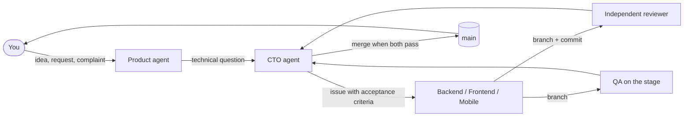

# TeamKit

**Run a small software team of AI coding agents, and stay in control of it.**

TeamKit is my own practical take on **Spec-Driven Development (SDD)** for building products with AI agents: the specification (a user story and acceptance criteria) comes first, the agents build against it, and independent checks hold the work to it.

It is a ready-made way of working for a team of [Claude Code](https://claude.com/claude-code) agents. Each agent is a separate session with one role (product, CTO, backend, frontend, independent reviewer, QA, ...). The roles share one set of rules: who decides what, how work is specified before it is built, who checks it, and what reaches your live system. You install it, answer a short interview, and get a project folder in which those agents can start working.

**New here? Read [`QUICKSTART.md`](QUICKSTART.md) (15 minutes).**

## Who it is for

- **A solo founder, product manager or tech lead** who builds a real product with Claude Code and has outgrown one long chat.
- **Anyone who wants AI agents to work like a team, not like one tireless intern:** with specs, ownership, reviews and a release gate.
- **Teams trying Spec-Driven Development with AI agents** who want a working process, not only a spec format.
- **People who want to keep the decisions.** The agents do the work; you decide goals, priorities, money, live data and anything irreversible.

It is not a framework or a library you import. It is a set of plain Markdown documents (rules, role briefs, templates), a small project generator and a Claude Code plugin. It works with any stack.

## The problem it solves

One agent in one long session works well for small tasks. On a real product it breaks in familiar ways:

| Without a team structure | With TeamKit |
|---|---|
| The agent writes the code and then judges its own work | **Nobody grades their own homework:** an independent reviewer reads every change; QA checks it on a stage |
| Work starts from half a sentence, and you find out what was built afterwards | **Spec first:** every user-facing task has a user story and Given / When / Then acceptance criteria before work starts |
| Changes are first tried on your real data and real users | **Nothing runs first on the live system:** a stage with a copy of the data and every outward channel switched off, and a QA role that must pass the criteria there |
| You get walls of text, and questions arrive mixed with reports | **One question at a time, in a fixed table**, with the agent's recommendation and the options; reports are one line |
| Context is lost when a session is compacted | **Handoffs are files, not chat:** the tracker, the changelog and the session logs carry the state |
| The same mistake comes back next week | **A repeated mistake becomes code:** a test, a hook or a check, not another reminder |

## How a change flows



1. **You talk to the product agent.** It turns an idea into a decision or a question for you, and calls the CTO when there is a technical side.
2. **The CTO plans and assigns.** It writes the issue (user story, acceptance criteria, out of scope) and starts the right agent. It writes no product code.
3. **A developer agent builds it** on its own branch, with tests, and reports one line: the commit hash.
4. **Two independent checks:** the reviewer reads the diff (findings ranked by severity, with a concrete failure scenario); QA runs the change on the stage against the acceptance criteria.
5. **The CTO merges** only a verified hash, and you see the result in your own build.

## The roles

| Role | What it does |
|---|---|
| **Product** (entry role) | The session you talk to first. Strategy and positioning, priorities inside your goals, user stories and acceptance criteria, user-visible texts; brings your own decisions to you with a recommendation |
| **CTO** | Technical decisions, the tracker, which agents to start, merges verified work. Writes no product code |
| **Backend, Frontend, Mobile** | Build in their own folders and branches, with tests; never push |
| **MCP** (optional) | An agent interface to the product, for users who connect their own AI agents |
| **Code reviewer** | Independent read-only review through fixed lenses (correctness, security, data, multi-user, ...). Reports to the CTO, never to the author |
| **QA** | Runs the stage (a second instance on a copy of the data, with messages, payments and model calls replaced) and passes each issue's criteria before it reaches your live system |
| **Web QA** | Checks the web interface in a real browser against a test setup |
| **Analyst** (optional) | Independent check of business logic: process, flows, requirements |

Not every project needs every role. The generator picks a preset by the kind and depth of the project; a small one starts with Product, CTO, Backend and Reviewer.

## Principles

- **You decide; agents recommend.** Goals, priorities, money and tokens, live data, anything legal or irreversible are yours. A question from you is never taken as approval.
- **Spec before code (SDD).** Acceptance criteria are written before the work, the work is built and tested against them, and the reviewer and QA check it against the same spec. A risky change takes the full spec lane: a short intent note, examples written as testable criteria (EARS form for failure cases), a plan reviewed before any code, and tests written by someone other than the builder.
- **Separation of duties.** The author does not review its own work, the tester is not the builder, and only one agent writes to the tracker.
- **Nothing first runs on the live system.** Changes that show, store, send, spend or migrate go through the stage and QA first.
- **Short, faithful reporting.** A failing test or a skipped step is said plainly; one line per event.
- **Rules grow from real mistakes,** and a mistake that repeats becomes an automatic check.

## Get started

### As a Claude Code plugin (prototype)

```bash
claude plugin marketplace add ioncat/teamkit
claude plugin install teamkit@teamkit
```

Open an empty folder in Claude Code and run `/teamkit:init`. Claude acts as the product agent of the new project: it interviews you one question at a time (kind, stack, depth, tracker, language, whether the product sends messages or spends tokens), writes the project files with the generator, fills the blanks with you, and tells you which sessions to open. `/teamkit:update` (read-only for now) tells a project built with an older TeamKit what it needs to catch up. To try it without installing: `claude --plugin-dir <this folder>`.

### With the generator

```bash
python tools/new_project.py --out <new folder>
```

It asks the same questions and builds a folder with only the roles and rules that fit. Python 3.10 or newer. `--dry-run` shows the plan without writing anything.

### By hand

Copy this folder, fill the blanks marked `<<...>>`, and follow [`QUICKSTART.md`](QUICKSTART.md).

## What is inside

| Path | What it is |
|---|---|
| `docs/team/AGENT_TEAM_RULES.md` | The common rules every agent follows: reports, talking to the owner, commits, data, safety, quality gates |
| `docs/team/roles/` | One startup brief per role |
| `docs/team/START_PROMPTS.md` | The one-line start message of each role and the launch order |
| `docs/team/WORK_MODES.md` | Two modes: `auto` (agents work almost alone) and `manual` (you work alongside) |
| `docs/team/FILE_LAYOUT.md` | The folder skeleton every project shares |
| `docs/delivery/` | Templates the project fills: its rules addendum (tracker, file ownership), per-role addenda, documentation conventions, changelog, review findings |
| `docs/agentic-sdlc-v1.md` | The delivery method: a spec lane and a fix lane chosen by risk |
| `CLAUDE.md` | Project instructions with blanks (stack, commands, critical rules) |
| `skills/`, `.claude-plugin/` | The plugin: `/teamkit:init` and `/teamkit:update` |
| `tools/new_project.py` | The project generator, with tests |

## Status

Young and evolving: version 0.4.1 (see [`TEAMKIT_CHANGELOG.md`](TEAMKIT_CHANGELOG.md)). It was extracted from the daily work of one owner with a team of agents on a real product, and every rule in it came from a real situation. The spec lane is defined but not yet piloted end to end; the plugin is a prototype.

## Hygiene

No personal data, secrets or real names in tracked files; fixtures are synthetic. Add a guard test in the first week (`tests/test_no_personal_data.py` in your own style).

## Sources

The methods, standards and Claude Code practices TeamKit is built on, and what each one gave: [`docs/SOURCES.md`](docs/SOURCES.md).

## License

MIT, see [`LICENSE`](LICENSE).
