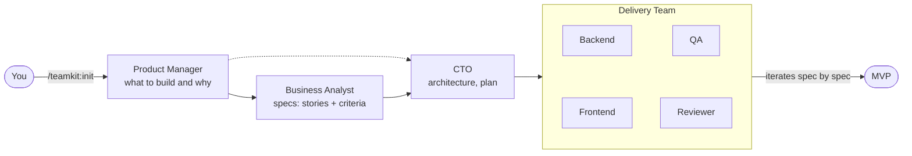

# TeamKit

**Helps you set up, run and operate a team of Claude Code agents, from spec to merge.**

TeamKit is a practical take on **Spec-Driven Development**: the spec (user story and acceptance criteria) comes first, agents build against it, independent checks hold the work to it. It builds on ideas from [GitHub Spec Kit](https://github.com/github/spec-kit) and adds what Spec Kit leaves out: a team of agents with separate roles, and gates before anything reaches your live system.

For anyone who builds a real product with [Claude Code](https://claude.com/claude-code) and has outgrown one long chat.

## Why a team, not one agent

One agent doing everything mixes product questions, code, reviews and tests in one context: it forgets, drifts and grades its own work. In TeamKit each agent is a separate session that knows one area well and keeps its context clean; agents hand work to each other through files and the tracker, not through one long chat.

| Role | Does |
|---|---|
| **Product Manager** | Your first contact. Keeps three answers written for every request: what problem we solve, for whom (the user), what value the user gets. Strategy and positioning, market and competitor analysis, validation of your ideas, priorities and the roadmap's meaning, user-visible texts; brings you only the decisions that are yours, with a recommendation |
| **Business Analyst** | Discovery of each request: what exists, the users and edge cases, open questions; writes each task as a user story with Given / When / Then acceptance criteria and what is out of scope |
| **CTO** | Architecture and technical decisions; adds feasibility, effort and technical notes to each task, picks and starts the right agent, keeps the tracker true, merges only verified work; writes no product code |
| **Backend / Frontend / Mobile** | Build in their own area and branch, test first, report one commit hash; never push, never touch another role's files |
| **Reviewer** | Independent review of the changes the CTO sends (risky ones always): code, security, data, logic and flows; findings ranked by severity with a concrete failure scenario |
| **QA** | In a project with a stage: runs it (a copy of the data, nothing sent outside) and passes each task's acceptance criteria through the real API and app before it reaches you |

Roles are plain Markdown briefs: add a role, give one deeper skills (a checklist, a playbook, a Claude Code skill), or drop the ones a project does not need.

## How a project runs



1. **The Product Manager** (an agent) interviews you: what you want to build, for whom, what problem it solves and what value it gives, what goes first.
2. **The Business Analyst** formalises it into specs (user stories, acceptance criteria): the Spec-Driven Development documentation. The CTO may join this step early.
3. **CTO** turns the specs into architecture and a technical plan, and starts the team.
4. **The Delivery Team** (Backend, Frontend, QA, Reviewer) builds spec by spec, each change tested and reviewed, until the MVP.

You decide goals, money, live data and anything irreversible.

## Principles

- **Spec before code.** No task starts without acceptance criteria.
- **Nobody grades their own homework.** An independent Reviewer reads the changes; QA tests them.
- **Nothing runs first on your live system.** Changes that push, spend or write live data pass on a stage first.
- **You decide, agents recommend.** One question at a time, with a recommendation.
- **A repeated mistake becomes code:** a test or a check, not another reminder.

## Get started

1. Add the plugin (once, in a terminal):

   ```bash
   claude plugin marketplace add ioncat/teamkit
   claude plugin install teamkit@teamkit
   ```

2. Open an empty folder in Claude Code.
3. Run:

   ```
   /teamkit:init
   ```

   The Product Manager interviews you, then you get a ready project folder and the list of sessions to open.

Other ways and details: [`QUICKSTART.md`](QUICKSTART.md).

## More

- Roles: [`docs/team/roles/`](docs/team/roles/) · Rules: [`docs/team/AGENT_TEAM_RULES.md`](docs/team/AGENT_TEAM_RULES.md) · Method: [`docs/agentic-sdlc-v1.md`](docs/agentic-sdlc-v1.md)
- Status: young, version 0.4.2 ([changelog](TEAMKIT_CHANGELOG.md)); extracted from daily work on a real product; the plugin is a prototype.
- License: MIT.
